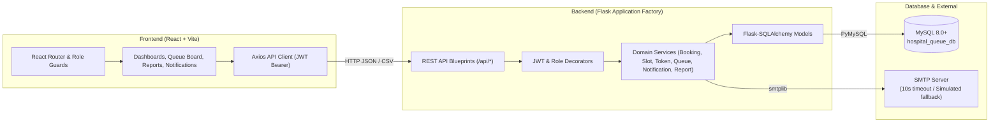

# System Architecture

## Project 25: Smart Hospital Appointment and Patient Queue Management System

---

## 1. High-Level Architecture

The application follows a 3-tier modular architecture:



---

## 2. Directory Layout

```text
.
├── .env.example
├── .gitignore
├── backend/
│   ├── app/
│   │   ├── __init__.py          # create_app() factory
│   │   ├── config.py            # Environment-driven configuration
│   │   ├── extensions.py        # SQLAlchemy & CORS instances
│   │   ├── models/              # SQLAlchemy ORM models
│   │   ├── routes/              # Modular Flask blueprints
│   │   ├── services/            # Deterministic business logic services
│   │   └── utils/               # Timezone helpers, error handlers, JWT/RBAC
│   ├── database/
│   │   ├── schema.sql           # InnoDB schema with active_slot_key generated column
│   │   └── seed.sql             # Seed data with Werkzeug password hashes & CURDATE()
│   ├── scripts/
│   │   └── generate_seed_hashes.py
│   ├── tests/                   # pytest test suites
│   ├── requirements.txt
│   └── run.py
├── frontend/
│   ├── index.html
│   ├── package.json
│   ├── vite.config.js
│   └── src/
│       ├── api/client.js        # Axios client with Bearer token & 401 handling
│       ├── components/          # Navbar, ProtectedRoute (role guards)
│       ├── context/AuthContext.jsx
│       ├── pages/               # LoginPage, RegisterPage, PatientDashboard, staff & queue pages
│       └── test/                # Vitest + React Testing Library setup and suites
└── docs/
    ├── SRS.md
    ├── ER_AND_UML_DIAGRAMS.md
    └── ARCHITECTURE.md
```

---

## 3. REST API Endpoint Reference

| Method | Endpoint | Roles Allowed | Description |
| :--- | :--- | :--- | :--- |
| `GET` | `/api/health` | Public | Health check, service status, hospital timezone, DB connectivity |
| `POST` | `/api/auth/register` | Public | Self-register as `PATIENT` and create linked `patients` record |
| `POST` | `/api/auth/login` | Public | Authenticate user and return 8-hour JWT bearer token |
| `GET` | `/api/auth/me` | Authenticated | Return current user details and linked patient/doctor profile IDs |
| `GET` | `/api/departments` | Public / Auth | List all hospital departments |
| `POST` | `/api/departments` | `ADMIN` | Create a new department |
| `GET` | `/api/doctors` | Public / Auth | List doctors (optional `department_id`, `active_only`, `include_schedules` filters) |
| `GET` | `/api/doctors/<id>` | Public / Auth | Retrieve single doctor profile including schedules |
| `POST` | `/api/doctors` | `ADMIN` | Create a doctor user account + doctor profile (`doc_code`, room, etc.) |
| `GET` | `/api/doctors/<id>/schedules` | Public / Auth | List schedules for a specific doctor |
| `POST` | `/api/doctors/<id>/schedules` | `ADMIN` | Add a weekday schedule for a doctor (validates no overlap) |
| `GET` | `/api/doctors/<id>/slots` | Public / Auth | Compute open/booked slots and remaining capacity for `?date=YYYY-MM-DD` |
| `GET` | `/api/patients` | `ADMIN` | List/search patients for walk-in booking (`?search=`) |
| `POST` | `/api/appointments` | `PATIENT`, `ADMIN` | Online appointment booking (`BOOKED`, issues `<DOC_CODE>-<3-digit-seq>`) |
| `POST` | `/api/appointments/walk-in` | `ADMIN` | Walk-in registration & booking (`CONFIRMED`, auto-assigns next free slot if `slot_time` omitted) |
| `GET` | `/api/appointments` | `PATIENT`, `DOCTOR`, `ADMIN` | List appointments (role-scoped; filterable by `date`, `doctor_id`, `status`, `include_history`) |
| `PATCH` | `/api/appointments/<id>/status` | `PATIENT`, `DOCTOR`, `ADMIN` | Transition appointment status via state machine and write `appointment_status_history` |
| `PATCH` | `/api/appointments/<id>/reschedule` | `PATIENT`, `ADMIN` | Reschedule a `BOOKED` or `CONFIRMED` appointment |
| `POST` | `/api/appointments/<id>/cancel` | `PATIENT`, `ADMIN` | Cancel a `BOOKED` or `CONFIRMED` appointment and free the slot |
| `GET` | `/api/queue` | Public / Auth | Ordered daily queue (`?date=&doctor_id=&department_id=`) |
| `GET` | `/api/notifications` | `PATIENT`, `DOCTOR`, `ADMIN` | Paginated notification logs scoped by role |
| `GET` | `/api/reports/daily` | `ADMIN` | Daily summary counts, status breakdown, per-doctor, hourly distribution |
| `GET` | `/api/reports/daily/export` | `ADMIN` | Download CSV export of daily appointments |

---

## 4. Appointment Status State Machine

| Current Status | Next Status | Allowed Roles | Guards & Side Effects |
| :--- | :--- | :--- | :--- |
| `BOOKED` | `CONFIRMED` | `ADMIN` | Logs status history and triggers notification |
| `CONFIRMED` | `IN_CONSULTATION` | `DOCTOR` (own), `ADMIN` | Rejects (`409`/`400`) if doctor already has another appointment `IN_CONSULTATION` |
| `IN_CONSULTATION` | `COMPLETED` | `DOCTOR` (own), `ADMIN` | Terminal state; logs history and triggers notification |
| `BOOKED` / `CONFIRMED` | `CANCELLED` | `PATIENT` (own), `ADMIN` | Terminal state; `active_slot_key` becomes `NULL` freeing the slot |
| `BOOKED` / `CONFIRMED` | `NO_SHOW` | `DOCTOR` (own), `ADMIN` | Terminal state; allowed only on or after `appointment_date` in `HOSPITAL_TIMEZONE` |

---

## 5. Concurrency & Duplicate-Slot Protection Design

1. **Database-Level Unique Active Slot Constraint:**
   MySQL 8.0 does not support partial unique indexes (`WHERE status != 'CANCELLED'`). Instead, `appointments` defines a `STORED` generated column:
   ```sql
   active_slot_key VARCHAR(64) GENERATED ALWAYS AS (
       CASE
           WHEN status = 'CANCELLED' THEN NULL
           ELSE CONCAT(doctor_id, '|', appointment_date, '|', slot_time)
       END
   ) STORED,
   UNIQUE KEY uq_appointments_active_slot_key (active_slot_key)
   ```
   Because MySQL `UNIQUE` indexes allow multiple `NULL` values, any number of cancelled appointments can exist for a slot while strictly preventing more than one non-cancelled appointment for `(doctor_id, appointment_date, slot_time)`.
2. **Atomic Sequential Token Generation:**
   Inside the booking transaction, `doctor_token_counters` is locked/incremented atomically per `(doctor_id, token_date)` so concurrent bookings never receive duplicate token numbers, and cancelled token numbers are never reused.
