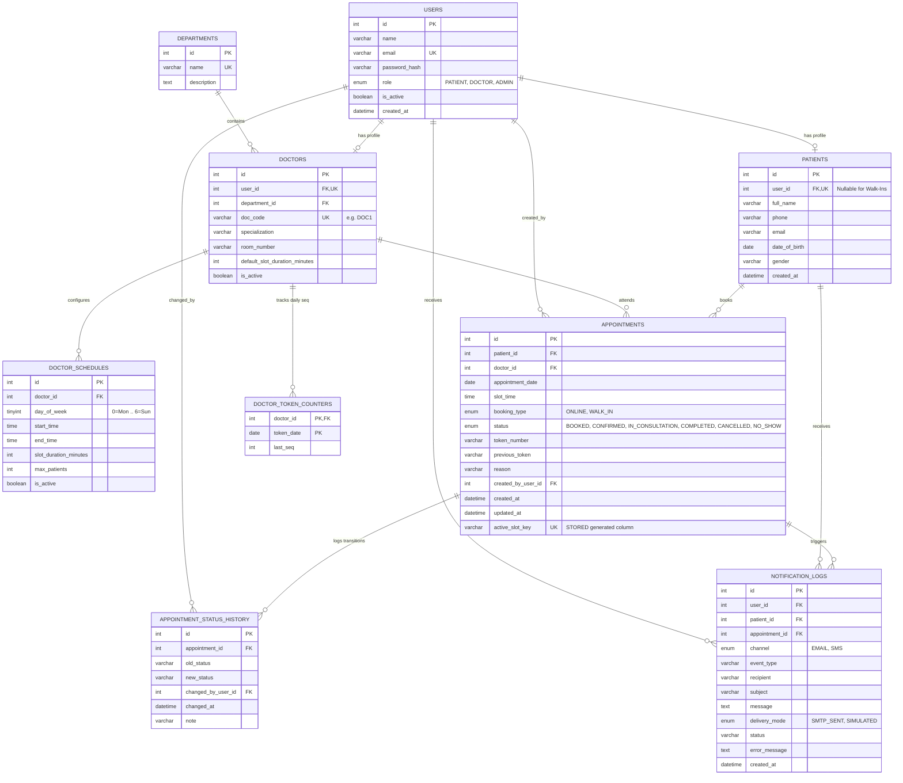
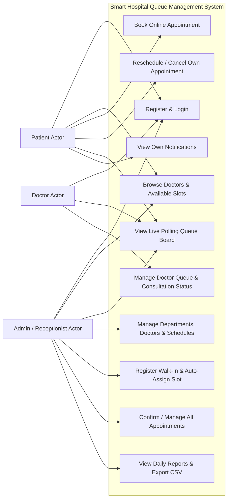
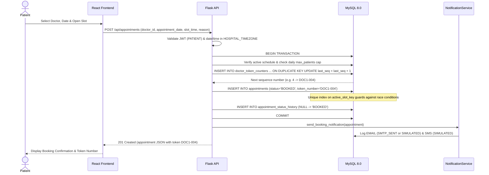
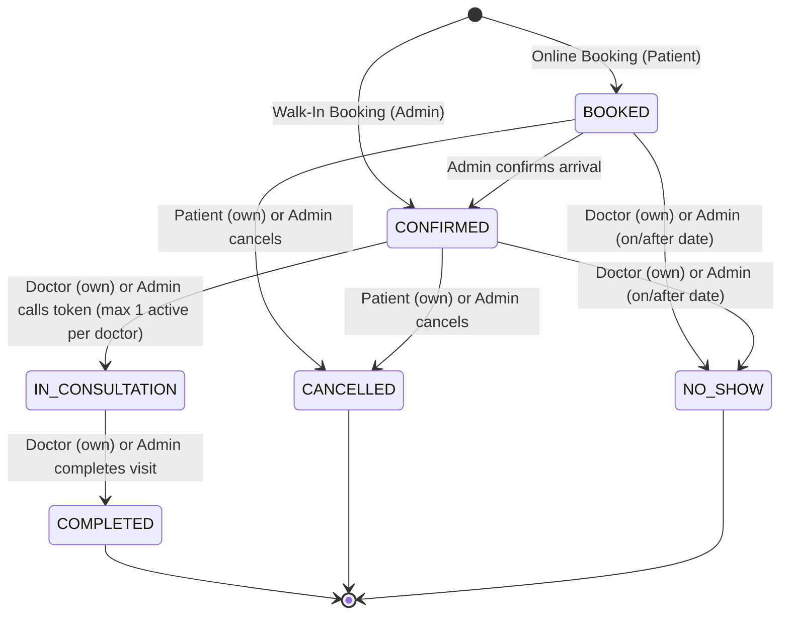

# ER and UML Diagrams

## Project 25: Smart Hospital Appointment and Patient Queue Management System

---

## 1. Entity-Relationship (ER) Diagram

---

## 2. Use-Case Overview Diagram

---

## 3. Sequence Diagram: Online Booking & Token Issuance

---

## 4. Activity / State Diagram: Appointment Queue Lifecycle

